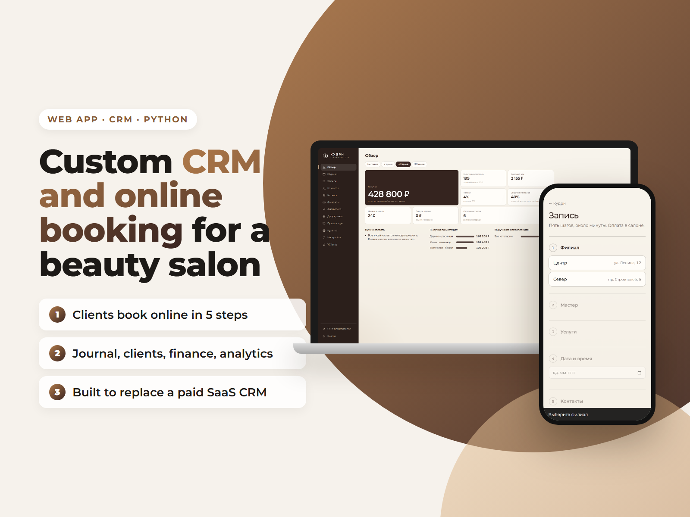
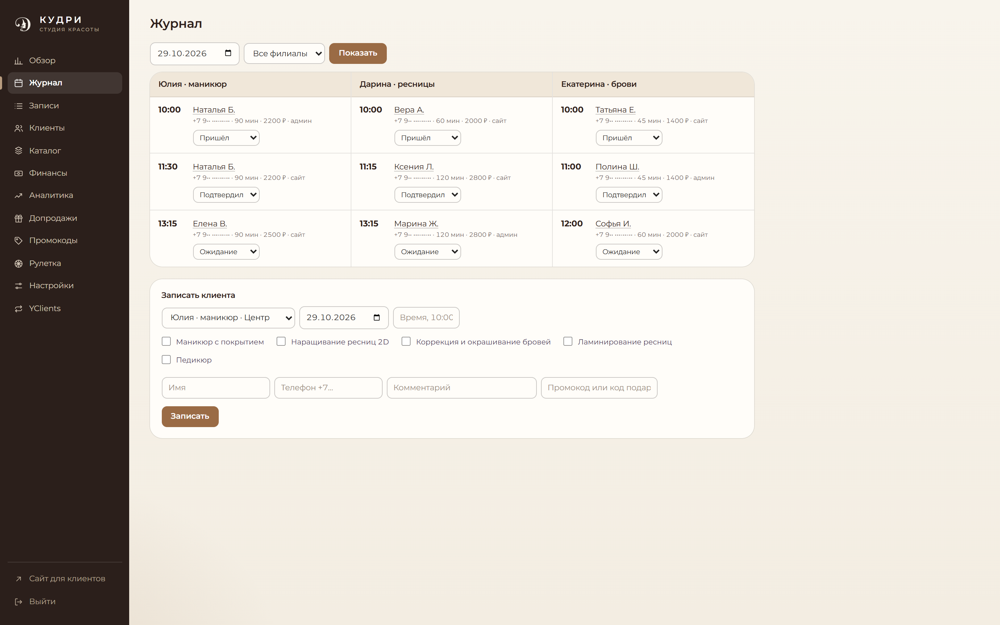
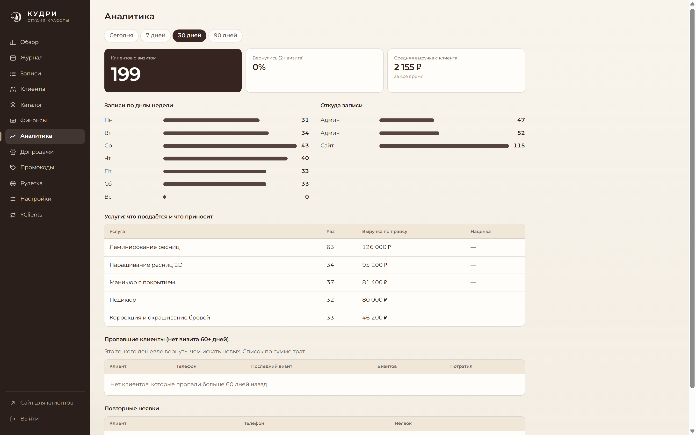
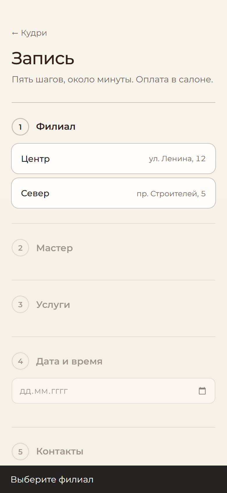

# Online Booking Page + Admin Panel for a Beauty Salon



A mobile-first online booking page and an admin panel for a beauty salon, written in plain Python with no framework and no build step. Clients book in a few steps: branch, master, services, time, contacts. Screenshots use demo data.

**Features**
- Booking flow: branch → master → services → date and time → contacts, with free-slot calculation
- Admin panel: schedule journal, clients, services catalog, payments and expenses, revenue analytics
- Promo codes, gift codes and upsell offers on the thank-you page
- Session auth with CSRF protection, PBKDF2 password hashing
- YClients sync in preview mode (writes only after human confirmation)

**Stack:** Python (stdlib `http.server`), SQLite, HTML/CSS/JS

| Journal | Analytics | Mobile booking |
|---|---|---|
|  |  |  |

## Quick start

```bash
python server.py            # http://127.0.0.1:8080, /book and /admin
```

---

**Подробное описание на русском ниже.**

# Кудри: страница записи и админка (локальный прототип)

Запуск: `python server.py` -> http://127.0.0.1:8080
- Запись: `/book`. Админка: `/admin`, логин `admin`, пароль в `data/admin_password.txt` (не коммитить).
- Данные только тестовые, база SQLite `data/kudri.db`.
- `yclients_sync.py`: пока предпросмотр, запись в YClients только после подтверждения человека.
- Спецификация: `docs/reverse-engineering.md`.
